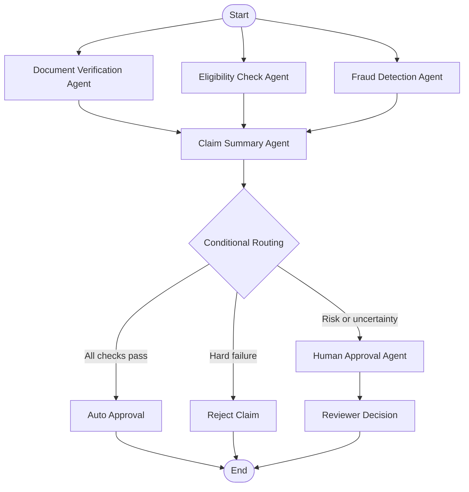

# 🛡️ Insurance Claim Processing Agent using LangGraph

An AI-powered Insurance Claim Processing Agent built with **LangGraph, Gemini 3.6 Flash, and Streamlit** to automate insurance claim verification, policy eligibility checks, fraud risk screening, claim summarization, and human review.

## 📌 Project Overview

Insurance claim processing often involves reviewing documents, checking policy validity, identifying potential fraud indicators, and deciding whether a claim requires further investigation.

This project implements an AI-assisted workflow that processes claim details and supporting document information through multiple specialized agents. It uses parallel execution for initial checks and conditional routing to determine the next step.

## 🎯 Objectives

- Verify required insurance claim documents.
- Check policy eligibility and coverage dates.
- Identify potential fraud risk indicators.
- Generate concise claim summaries using Gemini 3.6 Flash.
- Automatically route claims to approval, rejection, or human review.
- Provide an interactive web interface using Streamlit.

## ✨ Key Features

- **Multi-agent architecture:** Five required agent roles implemented as LangGraph nodes.
- **Parallel processing:** Document verification, eligibility checking, and fraud screening run in parallel.
- **Conditional routing:** Routes claims based on the results of the verification agents.
- **LLM integration:** Uses Gemini 3.6 Flash to generate claim summaries.
- **Human-in-the-Loop:** Provides reviewer controls for claims requiring manual review.
- **Interactive dashboard:** Enter claim information and view the output of each agent.
- **Sample scenarios:** Includes test cases for approval, missing documents, high-value claims, and expired policies.
- **Fallback summaries:** Uses a local summary if Gemini is unavailable.

## 🏗️ System Architecture



## 🤖 Agents and Responsibilities

| Agent | Responsibility |
|---|---|
| Document Verification Agent | Checks whether all required document names are present. |
| Eligibility Check Agent | Checks policy status and incident dates against policy coverage dates. |
| Fraud Detection Agent | Flags high-value claims and suspicious indicators for review. |
| Claim Summary Agent | Generates a concise summary using Gemini 3.6 Flash, with a fallback option. |
| Human Approval Agent | Routes uncertain or flagged claims for human review. |

## 🔄 Claim Processing Workflow

1. The application accepts claim details and selected supporting documents.
2. Three agents run in parallel to verify documents, check eligibility, and screen for risk indicators.
3. The Claim Summary Agent combines their results into a concise summary.
4. LangGraph conditional edges route the claim to one of three outcomes.
5. The Streamlit application displays the results and collects a reviewer decision when required.

### Decision Rules

| Condition | Outcome |
|---|---|
| Required documents are present, policy is eligible, and no risk flags are detected | Auto approved |
| Required documents are missing | Rejected |
| Policy is expired or incident falls outside the policy dates | Rejected |
| Claim amount meets the configured high-value threshold | Human review |
| Potential fraud indicators are detected | Human review |
| Policy dates are incomplete or uncertain | Human review |

These are configurable demonstration rules, not universal insurance industry standards.

## 🛠️ Technology Stack

- **Programming Language:** Python
- **Agent Workflow:** LangGraph
- **Large Language Model:** Google Gemini 3.6 Flash
- **LLM Integration:** LangChain Google Generative AI
- **Web Framework:** Streamlit
- **Environment Configuration:** python-dotenv
- **Development Environment:** Visual Studio Code and Jupyter Notebook

## 📁 Project Structure

```text
Insurance_Claim_Agent/
│
├── app.py
├── workflow.py
├── Insurance_Claim_Processing_Agent.ipynb
├── requirements.txt
├── .env.example
├── .gitignore
└── README.md
```

The `.venv/` directory is created locally and should not be committed to GitHub.

## ⚙️ Installation and Setup

### 1. Clone the repository

Replace `YOUR_USERNAME` with your GitHub username.

```bash
git clone https://github.com/YOUR_USERNAME/Insurance_Claim_Agent.git
cd Insurance_Claim_Agent
```

### 2. Create a virtual environment

For Windows Command Prompt:

```bat
py -m venv .venv
.venv\Scripts\activate
```

### 3. Install dependencies

```bash
python -m pip install --upgrade pip
pip install -r requirements.txt
```

### 4. Configure the Gemini API key

Obtain an API key from [Google AI Studio](https://aistudio.google.com/apikey).

Copy `.env.example` to `.env` and configure the values:

```ini
GOOGLE_API_KEY=your_gemini_api_key_here
GEMINI_MODEL=gemini-3.6-flash
```

Replace the placeholder with your actual API key. Ensure the model ID is supported by your API account.

**Security:** Never commit your `.env` file, expose your API key, or upload real customer insurance information to a public repository.

### 5. Run the Streamlit application

```bash
python -m streamlit run app.py
```

Open the local URL displayed in your terminal, typically:

```text
http://localhost:8501
```

## 📓 Running the Jupyter Notebook

Open `Insurance_Claim_Processing_Agent.ipynb` in Visual Studio Code.

1. Select the Python interpreter from `.venv`.
2. Run the notebook cells in order.
3. Execute the sample scenarios.
4. Review the agent outputs and expected decisions.

## 🧪 Test Scenarios

The project includes the following demonstration scenarios:

| Test Case | Description | Expected Outcome |
|---|---|---|
| Test 1 | Complete claim with valid documents and active policy | Auto approved |
| Test 2 | Claim with missing required documents | Rejected |
| Test 3 | High-value claim with valid documents | Human review |
| Test 4 | Claim submitted under an expired policy | Rejected |

## 👤 Human-in-the-Loop

Claims with risk indicators or uncertain eligibility information are routed for human review.

The reviewer can:

- Approve the claim.
- Reject the claim.
- Request additional information.
- Add review notes explaining the decision.

The application records the reviewer decision in the current session. Persistent audit logging and a production-grade approval system are not included.

## 🚀 Future Enhancements

- Upload and extract information from PDF and image documents.
- Validate document contents and authenticity.
- Integrate with policy databases and insurance APIs.
- Improve fraud screening using historical claim data and anomaly detection.
- Add a persistent database for claims and reviewer decisions.
- Implement authentication, role-based access control, and audit logs.
- Add automated testing and deployment through CI/CD.
- Deploy the Streamlit application to a hosting platform.

## ⚠️ Limitations and Disclaimer

This project is an educational prototype intended to demonstrate agent workflows and LLM integration.

- Document verification checks selected document names rather than actual document contents.
- Fraud indicators are signals for investigation, not proof of fraud.
- The high-value threshold and routing rules are configurable demonstration settings.
- Gemini API availability depends on the model endpoint, quota, and account configuration.
- The application is not a substitute for official policy interpretation or professional claims assessment.

**Do not use this prototype as the sole basis for real insurance approvals, rejections, or fraud allegations.**

## 👨‍💻 Author

**Bhushan Mandekar**

---

⭐ If you find this project useful, consider giving the repository a star.
